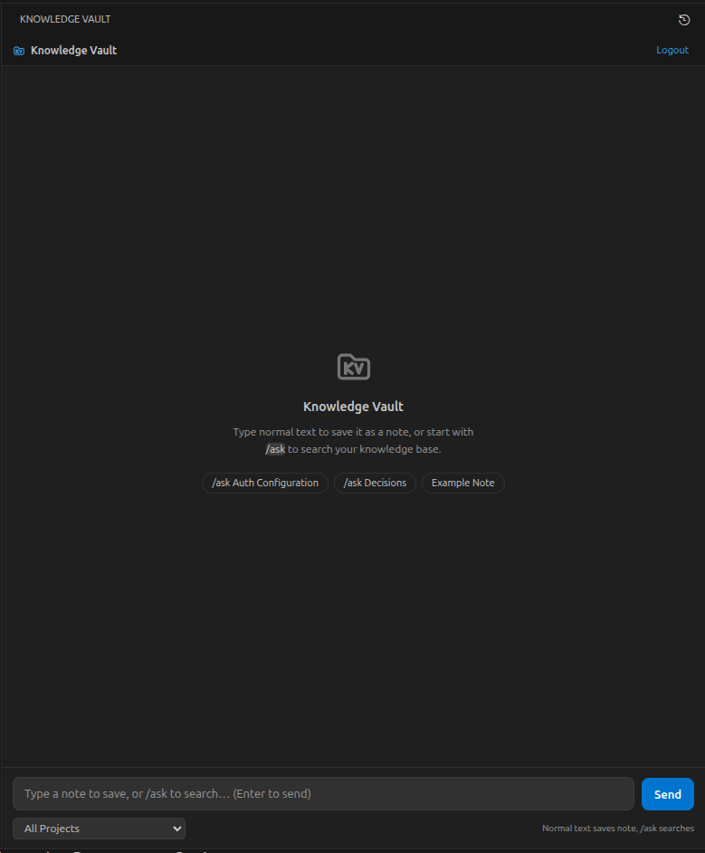

# Kote for VS Code

Integrate your Kote directly into VS Code — search, ask AI, save notes without leaving your editor.

## About Kote

**Kote** is a developer memory layer that automatically captures and organizes AI sessions, Git history, and development context into searchable knowledge.

For more details, visit the [GitHub Repository](https://github.com/pedroaugusto04/Kote) or the [original link](https://knowledgebase.sbs/kote).

## Features

- **CodeLens Integration**: Automatically displays relevant notes and decisions at the top of files that have associated knowledge in your Kote. Click the CodeLens indicator to view and open related notes directly in your editor.
- **Kote Code Lineage**: Highlight any code snippet and press `Ctrl+Shift+E` (or right-click → *"Kote: Explain Why This Code Exists"*) to view an interactive origin timeline of past decisions, git commit history, and related AI sessions specifically for the selected code.
- **Dedicated Sidebar**: Interactive AI chat and manual note saving
- **Quick AI Questions**: Ask questions without leaving your editor (`Ctrl+Shift+K`)
- **Save Code Selection**: Right-click any code selection to save as a note
- **Save Active File**: Save entire files directly to your Kote
- **AI Session History**: View and search recent AI-assisted development sessions
- **Session Handoffs**: Transfer active context seamlessly across AI agents and terminal harnesses

## Screenshots

  
   <em>Integrated sidebar with AI chat and quick-save commands for code selections.</em>

## Installation

### From VS Code Marketplace or Open VSX Registry

1. Open VS Code or your Open VSX-compatible editor (VSCodium, Gitpod, etc.)
2. Go to Extensions (`Ctrl+Shift+X`)
3. Search for "Kote"
4. Click Install

### Manual Installation

1. Download the latest `.vsix` file from the [Releases](https://github.com/pedroaugusto04/kote/releases) page
2. Open VS Code
3. Run "Extensions: Install from VSIX..." from the Command Palette (`Ctrl+Shift+P`)
4. Select the downloaded file

## Getting Started

### 1. Configure Your Kote

After installation, connect to your Kote instance:

1. Open the Kote sidebar (click the icon in the activity bar)
2. Enter your Kote API URL (defaults to `https://knowledgebase.sbs/kote/api` or your self-hosted backend)
3. Provide your API credentials / access token
4. Select your default workspace/project

### 2. Basic Usage

#### Ask AI Questions
**Keyboard Shortcut**: `Ctrl+Shift+K` (Windows/Linux) or `Cmd+Shift+K` (Mac)
Select code (optional), press shortcut, type question, get instant answers with workspace context.

#### Save Code Selection
Right-click highlighted code and select **"Kote: Save Selection as Note"** to store decisions and context.

#### Kote Code Lineage (Explain Why Code Exists)
**Keyboard Shortcut**: `Ctrl+Shift+E` (Windows/Linux) or `Cmd+Shift+E` (Mac)
Highlight code and trigger the command to explore an interactive timeline of commits, decisions, and related AI sessions.

---

## Data Transmission, Privacy & Git Metadata

Kote is designed to bridge your development work with your team knowledge base. Here is an explicit description of **what data is transmitted, where it is sent, and how you control it**:

### Where Data is Sent
All network transmissions go exclusively to your configured Kote backend:
* **Default URL:** `https://knowledgebase.sbs/kote/api`
* **Custom / Self-Hosted:** Configured in your settings or `~/.config/kb/config.json`. Kote never transmits data to third parties.

### What is Transmitted

1. **AI Session Data (AI History):**
   * **Content:** Prompts, assistant responses, model metadata, and token usage from detected sessions.
   * **Upload Setting:** Governed by `kote.aiSessionSaveMode` (see below).
2. **Git Commit Metadata:**
   * **Content:** When commits are made in your local repository, Kote synchronizes commit metadata (SHA, short SHA, commit message, author name, author email address, commit timestamp, branch name, list of changed file paths, and remote GitHub URL if configured).
   * **Purpose:** Correlates AI conversations and architecture decisions to concrete code changes in the **Kote Code Lineage** timeline.
   * **Control:** Can be disabled at any time via the `"kote.gitTracking.enabled": false` setting.
3. **User-Initiated Searches & Queries:**
   * Text questions or code snippets selected when using `Ask Kote` or `Explain Why This Code Exists`.

### AI Session Upload Modes (`kote.aiSessionSaveMode`)
* **`auto-save` (Default):** Automatically synchronizes detected AI sessions in the background. A non-intrusive notification is displayed when a session is saved.
* **`ask`:** Prompts you with an explicit confirmation dialog before uploading each newly detected session, allowing you to preview or reject it.
* **`ignore-all`:** Disables all automatic uploads. Sessions remain strictly local until manually imported.

You can change this mode at any time using the gear icon in the Kote sidebar title bar or by running **"Kote: Configure AI Session Save Mode"**.

---

## External Integrations & AI Harness Hooks

Kote offers optional session-handoff bridges with local AI developer harnesses to pass context between coding assistants:

### What External Tools are Modified
When enabled, Kote can integrate with:
1. **Claude Code (`~/.claude/`):**
   * **Target:** `~/.claude/settings.json`
   * **Action:** Adds a Kote-specific command to the native `session_start` hook, pointing to `~/.config/kote/hooks/kote-session-start.js`.
2. **Antigravity CLI (`~/.gemini/antigravity-cli/`):**
   * **Target:** `~/.gemini/antigravity-cli/hooks/kote-session-start.js`
   * **Action:** Copies the session-start hook bridge script into the Antigravity hooks directory.
3. **OpenCode (`~/.config/opencode/`):**
   * **Target:** `~/.config/opencode/plugins/kote-session-handoff.js`
   * **Action:** Copies the session handoff plugin into OpenCode's plugins directory.

### User Permission is Always Required
* **Opt-In Prompt:** Kote **does NOT** modify external tools silently. Upon first startup (if local harnesses are detected), Kote presents an explicit prompt:
  > *"Kote detected local AI tools (...). Would you like to enable session handoff integration?"*
* **Manual Control:** You can enable, review, or disable these integrations at any time using the command **`Kote: Configure External AI Harness Integrations`** or via the `"kote.integrations.enableHarnessHooks"` setting.

### Automatic Cleanup on Uninstall
If you uninstall the Kote VS Code extension:
* VS Code executes the extension lifecycle uninstall hook (`vscode:uninstall`).
* Kote automatically removes the `session_start` entry from `~/.claude/settings.json`.
* Kote deletes `session-start.js` from `~/.gemini/antigravity-cli/hooks/`.
* Kote deletes `kote-session-handoff.js` from `~/.config/opencode/plugins/`.
* Kote removes the temporary bridge scripts in `~/.config/kote/hooks/`.
* No orphan hooks or external modifications are left behind.

---

## Commands

| Command | Shortcut | Description |
|---------|----------|-------------|
| `Kote: Open Chat` | - | Open the AI chat in the sidebar |
| `Kote: Ask (Quick Input)` | `Ctrl+Shift+K` | Quick AI question from selected text |
| `Kote: Explain Why This Code Exists` | `Ctrl+Shift+E` | Open Kote Code Lineage origin timeline for selected code |
| `Kote: Save Selection as Note` | - | Save selected code as a note |
| `Kote: Save Active File as Note` | - | Save current file as a note |
| `Kote: View Recent AI Sessions` | - | Open AI session history viewer |
| `Kote: Configure AI Session Save Mode` | - | Switch between `auto-save`, `ask`, and `ignore-all` |
| `Kote: Configure External AI Harness Integrations` | - | Enable, view, or remove hooks in Claude Code, Antigravity, and OpenCode |
| `Kote: View Active Session Handoff` | - | Preview active session context handoff |
| `Kote: Generate & Copy Session Handoff` | - | Copy handoff markdown to clipboard |
| `Kote: Refresh Sidebar` | - | Refresh the sidebar content |

## Configuration Settings

| Setting | Default | Description |
|---------|---------|-------------|
| `kote.aiSessionSaveMode` | `"auto-save"` | Controls handling of AI sessions (`auto-save`, `ask`, `ignore-all`). |
| `kote.gitTracking.enabled` | `true` | Enable background synchronization of Git commit metadata to linked projects. |
| `kote.integrations.enableHarnessHooks` | `false` | Enable integration hooks in external tools (Claude Code, Antigravity, OpenCode). |
| `kote.inlineAnnotations.enabled` | `true` | Enable inline annotations for code decisions and context. |
| `kote.inlineAnnotations.showHover` | `true` | Show rich hover tooltips on active lines with Kote context. |
| `kote.antigravityLogPath` | `""` | Custom path to Antigravity brain directory (defaults to standard location). |
| `kote.claudeCodeLogPath` | `""` | Custom path to Claude Code directory (defaults to standard location). |
| `kote.codexLogPath` | `""` | Custom path to Codex CLI directory (defaults to standard location). |
| `kote.opencodeDbPath` | `""` | Custom path to OpenCode database file (defaults to standard location). |

## License

See [LICENSE](../../blob/main/LICENSE) for terms of use.
